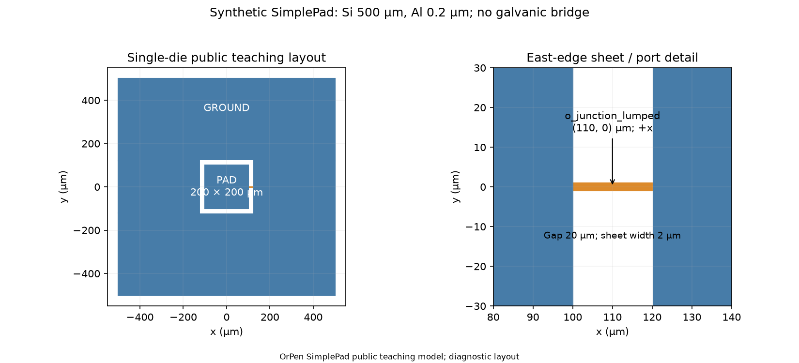

# SCGSim

**Simulate superconducting layouts with Python.**

SCGSim prepares Palace and Ansys AEDT simulations, then returns capacitance, resonant modes, S-parameters and per-length line results with units.

## Choose a simulation

| Goal | Start here |
|---|---|
| Capacitance | [Palace Electrostatic or AEDT Q3D](docs/tutorials/capacitance.qmd) |
| Resonance and EPR | [Palace or HFSS modes](docs/tutorials/resonance.qmd) · [Energy participation](docs/tutorials/resonance-epr.qmd) |
| Driven S-parameters | [HFSS Modal or Terminal](docs/tutorials/scattering.qmd) |
| Transmission-line parameters | [AEDT Q2D](docs/tutorials/transmission-line.qmd) |

## Prepare, configure, run, read

Define the geometry, configure the model, run on its solver host, then read the returned quantities with their units.

**[Install SCGSim](docs/course/installation.qmd)** · **[Choose a simulation](docs/examples.qmd)**
