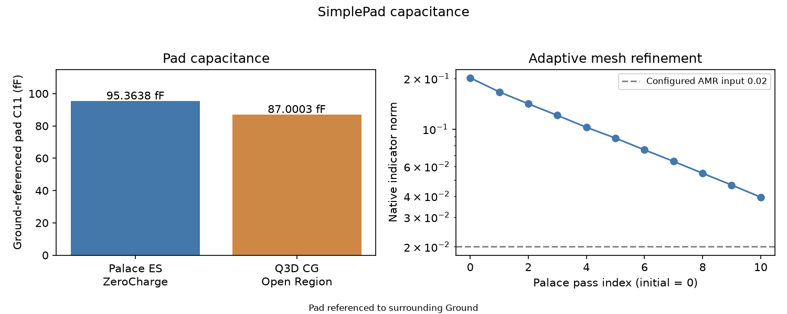

## 1. What you will get

This notebook prepares a square pad and its surrounding Ground for an electrostatic extraction. Choose Palace Electrostatic or AEDT Q3D, run it on a host with the corresponding native solver, then read the returned capacitance matrix with its terminal labels and units.

{#fig-simple-pad-layout}

The layout is a declared model: a 200 µm square pad, a 20 µm gap, a 1000 µm square die, 0.2 µm aluminum and 500 µm silicon. This calculation has no inductive branch. The backend boundary choices are different, so their matrices are separate results for their respective field models.

## 2. Prepare your environment

Create a study project with Python 3.12 or 3.13. Install Git and [uv](https://docs.astral.sh/uv/getting-started/installation/); uv uses Git to fetch the pinned source without requiring you to clone or edit SCGSim.

```bash
uv init --python 3.12 pad-capacitance
cd pad-capacitance
uv add 'scgsim[palace,aedt] @ git+https://github.com/NCUPHY-LTLab/scgsim.git@90fb50ef9de80fa6e556d2f2a09fb45707efeea0' \
  'orpen-sc-pdk @ git+https://github.com/NCUPHY-LTLab/orcapen-sc-pdk.git@51985d9507025e8241205712e866c0b804de29b9' \
  ipykernel
uv run python -c "from importlib.metadata import version; print(version('scgsim'))"
uv run --with jupyter jupyter lab
```

The source pin is SCGSim `2.0.0rc11`. The SimplePad source pin is the public OrPen SC PDK revision `51985d9507025e8241205712e866c0b804de29b9`; its distribution name remains `orpen-sc-pdk` and its import name is `orpen_sc_pdk`. uv creates this project's `.venv` and records exact resolutions in `uv.lock`.

| Backend | Native software needed on the solver host |
|---|---|
| Palace | Official Palace 0.18.1 plus a site MPI wrapper accepting `-np` and `-nt` |
| AEDT Q3D | AEDT 2023.2 or 2024.2, PyAEDT 1.3.0 and a suitable license |

The Python extra prepares inputs; it does not install either native solver. See [SCGSim installation](../course/installation.qmd) for project and solver setup details.

Check: the version command prints `2.0.0rc11`; Jupyter uses the study project's Python environment.

## 3. Choose your settings

Edit these values before building the source. Dimensions and padding are in micrometres; the Q3D setup frequency is in GHz.

```{python}
#| id: cap-settings
from pathlib import Path

PAD_SIDE_UM = 200.0
GAP_UM = 20.0
DIE_SIDE_UM = 1000.0
PORT_LOCATOR_WIDTH_UM = 2.0
VACUUM_PADDING_UM = (250.0, 250.0, 1000.0)
OUTPUT_ROOT = Path(".artifacts/SimplePad")
PALACE_RUN_ID = "pad-capacitance-palace-01"
Q3D_RUN_ID = "pad-capacitance-q3d-01"
PALACE_HANDOFF_NOTE = OUTPUT_ROOT / f"{PALACE_RUN_ID}-handoff.json"

PALACE_EXECUTABLE = "palace"  # Set to your site's MPI wrapper accepting -np/-nt.
PALACE_RESOURCES = {
    "processes": 8,
    "threads": 1,
    "command_style": "wrapper",
}
PALACE_SETUP_COMMANDS = ()
AEDT_CORES = 4
AEDT_RAM_LIMIT_PERCENT = 80

PALACE_REFINED_MESH_UM = 10.0
PALACE_MAX_MESH_UM = 200.0
PALACE_FEM_ORDER = 2
PALACE_AMR_MAX_PASSES = 10
PALACE_AMR_TOLERANCE = 0.02

AEDT_VERSION = "2024.2"  # Select 2023.2 or 2024.2 for your licensed host.
Q3D_FREQUENCY_GHZ = 5.0
Q3D_MAXIMUM_PASSES = 10
Q3D_CONVERGENCE_PERCENT = 1.0
```

The mesh pair controls Palace element sizing; FEM order controls field approximation separately. Q3D frequency and pass settings define the native matrix request. Keep these inputs with the returned run because they affect the extracted matrix.

Check: review units, choose solver controls for your model, and use a fresh run name for each preparation.

## 4. Build the model

The following cell builds the public SimplePad component and one immutable geometry snapshot shared by both solver routes. It assigns the pad and Ground nets explicitly and adds a vacuum envelope around the die.

### Create the shared source {#create-the-shared-source}

```{python}
#| id: cap-source
import gdsfactory as gf
import orpen_sc_pdk
from orpen_sc_pdk import get_material_records
from orpen_sc_pdk.tech import get_single_die_layer_stack
from IPython.display import display
from scgsim.geometry import GeometryPlan

orpen_sc_pdk.activate()
gf.clear_cache()
component = gf.get_component(
    "square_pad_capacitor",
    pad_side_um=PAD_SIDE_UM,
    gap_um=GAP_UM,
    die_side_um=DIE_SIDE_UM,
    junction_width_um=PORT_LOCATOR_WIDTH_UM,
)
layer_stack = get_single_die_layer_stack()
material_records = get_material_records()
plan = GeometryPlan(
    component=component,
    root_id="chip",
    layer_stack=layer_stack,
    material_records=material_records,
    coupon_padding_um=0.0,
)
plan.set_nets({"pad": ("chip/PAD",), "ground": ("chip/GROUND",)})
plan.set_vacuum_region(padding=VACUUM_PADDING_UM)
snapshot = plan.prepare()
display(component)
print(component.dbbox())
```

The non-metal locator belongs to the authored component, but this capacitance model does not add a galvanic bridge or inductive branch. Palace uses the natural electrostatic exterior; Q3D uses an open Region. Record the selected backend with the matrix.

Check: the component preview shows the pad and surrounding Ground, and the snapshot contains the explicit `pad` and `ground` Nets.

See the [model and materials reference](../reference.qmd#model-materials) and [conductors and ports reference](../reference.qmd#conductors-ports).

## 5. Configure the simulation {#configure-the-extraction}

Choose one backend tab. The Palace request excites `pad` relative to `ground`. The Q3D request explicitly maps the snapshot's final nets to native net types and separately marks the physical Ground role; it requests C/G only.

:::: {.panel-tabset group="capacitance-backend"}

### Palace

```{python}
#| id: cap-palace-config
from scgsim.palace import ElectrostaticSim

palace_sim = ElectrostaticSim()
palace_sim.set_plan(snapshot)
palace_sim.set_surface_epr(representation="B", specs={})
palace_sim.set_output_dir(OUTPUT_ROOT / PALACE_RUN_ID)
palace_sim.add_terminal("pad", net_id="pad")
palace_sim.add_ground(net_id="ground")
palace_sim.set_electrostatic(
    save_fields=1,
    unassigned_conductor_policy="error",
    exterior_boundary_policy="none",
)
palace_sim.set_mesh(
    refined_mesh_size=PALACE_REFINED_MESH_UM,
    max_mesh_size=PALACE_MAX_MESH_UM,
)
palace_sim.set_numerical(
    order=PALACE_FEM_ORDER,
    tolerance=1e-6,
    max_iterations=2000,
    solver_type="Default",
    preconditioner="Default",
    device="CPU",
    amr_max_passes=PALACE_AMR_MAX_PASSES,
    amr_tolerance=PALACE_AMR_TOLERANCE,
    amr_update_fraction=0.15,
    amr_nonconformal=False,
    save_adapt_iterations=True,
    output_paraview=True,
    output_grid_function=False,
)
```

### AEDT Q3D

```{python}
#| id: cap-q3d-config
from scgsim.aedt import AedtResources, MatrixRunControl, PdkMaterial

q3d_materials = {
    material_id: PdkMaterial(
        material_id,
        material_records[material_id]["material_kind"],
        material_records[material_id]["is_superconducting"],
        material_records[material_id]["aedt_library_name"],
    )
    for material_id in ("Al", "Si", "vacuum")
}
q3d_run_control = MatrixRunControl(
    setup_name="Setup1",
    frequency_ghz=Q3D_FREQUENCY_GHZ,
    maximum_passes=Q3D_MAXIMUM_PASSES,
    convergence_percent=Q3D_CONVERGENCE_PERCENT,
)
q3d_resources = AedtResources(
    cores=AEDT_CORES,
    ram_limit_percent=AEDT_RAM_LIMIT_PERCENT,
)
print(q3d_materials, q3d_run_control, q3d_resources)
```

::::

Check: confirm the requested frequency, matrix setup, physical Ground Net and AEDT release before preparation. See [mesh and adaptation](../reference.qmd#mesh-adaptation).

## 6. Inspect and run {#execute-the-prepared-model}

Prepare the selected backend, then inspect its mesh and generated configuration or request before execution. With `command_style="wrapper"`, set `PALACE_EXECUTABLE` to your site's Palace MPI wrapper that accepts `-np` and `-nt`; keep `PALACE_SETUP_COMMANDS` empty for direct-local use, or set it to your site's documented setup commands. For a direct Palace ELF binary, follow the [execution and handoff reference](../reference.qmd#execution-handoff) to choose its matching launcher settings.

:::: {.panel-tabset group="capacitance-backend"}

### Palace

```{python}
#| id: cap-palace-prepare
import json

palace_mesh = palace_sim.mesh()
palace_config = palace_sim.write_config()
palace_handoff = palace_sim.prepare_handoff(
    profile="direct-local",
    executable=PALACE_EXECUTABLE,
    resources=PALACE_RESOURCES,
    setup_commands=PALACE_SETUP_COMMANDS,
)
PALACE_HANDOFF_NOTE.parent.mkdir(parents=True, exist_ok=True)
PALACE_HANDOFF_NOTE.write_text(
    json.dumps(
        {
            "run_dir": str(palace_handoff.run_dir),
            "handoff_id": palace_handoff.handoff_id,
        },
        indent=2,
    ),
    encoding="utf-8",
)
print(palace_mesh, palace_config, palace_handoff.run_dir)
print("Saved handoff identity:", PALACE_HANDOFF_NOTE)
```

The note stores the handoff ID beside the run folder so result resolution still works in a fresh kernel or after the run folder is transferred.

### AEDT Q3D

```{python}
#| id: cap-q3d-prepare
from scgsim.aedt import prepare_q3d_from_geometry

q3d_handoff = prepare_q3d_from_geometry(
    snapshot,
    aedt_version=AEDT_VERSION,
    modeling="solid",
    output_dir=OUTPUT_ROOT / Q3D_RUN_ID,
    project_name=Q3D_RUN_ID,
    design_name="SimplePadQ3d",
    materials=q3d_materials,
    net_types={"pad": "Signal", "ground": "Signal"},
    physical_ground_nets=("ground",),
    run_control=q3d_run_control,
    region_padding_um=(250.0, 250.0, 250.0, 250.0, 1000.0, 1000.0),
    resources=q3d_resources,
)
print(q3d_handoff.spec_path, q3d_handoff.archive_path)
```

::::

For Q3D, `Signal` asks the native matrix to retain a net as a matrix terminal, so this request maps both `pad` and `ground` to that row type. `physical_ground_nets=("ground",)` separately records Ground's physical role in the prepared geometry and boundary model.

Inspect the mesh, configuration, specification and archive before running a solver. For a remote host, transfer the complete archive and run its script there; the next cells execute locally on the selected solver host.

:::: {.panel-tabset group="capacitance-backend"}

### Palace

```{python}
#| id: cap-palace-execute
import subprocess

subprocess.run(
    ["bash", str(palace_handoff.script_path)],
    cwd=palace_handoff.run_dir,
    check=True,
)
```

### AEDT Q3D

```{python}
#| id: cap-q3d-execute
import subprocess

subprocess.run(
    ["bash", str(q3d_handoff.script_path)],
    cwd=q3d_handoff.run_dir,
    check=True,
)
```

::::

AEDT Desktop opens and releases on the same licensed host as the runner.

Check: the package path is new; after the runner completes, retrieve the full returned directory. See [execution and handoff](../reference.qmd#execution-handoff).

## 7. Read and plot results {#resolve-and-display-the-result}

Start a fresh analysis kernel and resolve the generated local run directory. For a transferred return, change only `RETURNED_RUN_DIR` to the returned folder; the independently saved Palace handoff note remains in the study project.

:::: {.panel-tabset group="capacitance-backend"}

### Palace

```{python}
#| id: cap-palace-results
import json
from pathlib import Path
from scgsim.palace import resolve_palace_result

PALACE_HANDOFF_NOTE = Path(
    ".artifacts/SimplePad/pad-capacitance-palace-01-handoff.json"
)
handoff_record = json.loads(PALACE_HANDOFF_NOTE.read_text(encoding="utf-8"))
RETURNED_RUN_DIR = Path(handoff_record["run_dir"])
EXPECTED_HANDOFF_ID = handoff_record["handoff_id"]
result = resolve_palace_result(
    RETURNED_RUN_DIR,
    expected_handoff_id=EXPECTED_HANDOFF_ID,
)
result.show_all_results()
```

Find the driven terminal's diagonal in the ground-referenced capacitance matrix. Read its row and column labels and the report's displayed unit before using the value.

### AEDT Q3D

```{python}
#| id: cap-q3d-results
from pathlib import Path
from scgsim.aedt import resolve_results

RETURNED_RUN_DIR = Path(".artifacts/SimplePad/pad-capacitance-q3d-01")
result = resolve_results(RETURNED_RUN_DIR)
result.show_all_results(show_details=True)
physics_rows = result.physics_results()
physics_rows
```

For this C/G-only extraction, identify the pad row and column in the returned capacitance and conductance matrices. `physics_results()` retains each native row's quantity, row, column, value and exported unit; keep those fields together because exported units may be scaled.

::::

Check: the report shows the actual returned status and labeled matrix rows. See [results and reports](../reference.qmd#results-reports).

### Historical SimplePad observations

The Palace and pre-v3 Q3D observations used SCGSim 1.0.1, and the Q3D input was a separate GDS-import workflow. They show example report entries, not expected values for a new run.

| Historical report entry | Value |
|---|---:|
| Palace, Ground-referenced pad diagonal $C_{11}$ | 95.36383731153 fF |
| Q3D, pad row/column $C_{\mathrm{pad,pad}}$ at 5 GHz | 87.00027087746 fF |

{#fig-simple-pad-capacitance}

## 8. Adapt this notebook

Change `PAD_SIDE_UM`, `GAP_UM`, `DIE_SIDE_UM` and the component parameters together so the geometry and declared problem still match. Keep the `pad` and `ground` Net assignments explicit. For another matrix representation or additional conductors, adapt the backend's own boundary and Net choices rather than treating a row index as a universal terminal identity.

Check: inspect the rebuilt component before creating a new handoff.

For a mode calculation, add the source-owned inductive locator and follow the standalone [resonance notebook](resonance.qmd). For a separate participation calculation, use [resonance and EPR](resonance-epr.qmd). The [Palace electrostatic](../course/palace-electrostatic.qmd) and [Q3D](../course/aedt-q3d.qmd) references describe backend-specific settings; [physical problem choices](../concepts/problems.qmd) connect a matrix entry to the intended circuit quantity.

Public source cases at the same PDK revision: [Palace SimplePad electrostatic](https://github.com/NCUPHY-LTLab/orcapen-sc-pdk/blob/51985d9507025e8241205712e866c0b804de29b9/notebooks/src/ComponentSimulation/SimplePad/palace_electrostatic.qmd) and [AEDT Q3D](https://github.com/NCUPHY-LTLab/orcapen-sc-pdk/blob/51985d9507025e8241205712e866c0b804de29b9/notebooks/src/ComponentSimulation/SimplePad/aedt_q3d.qmd).
