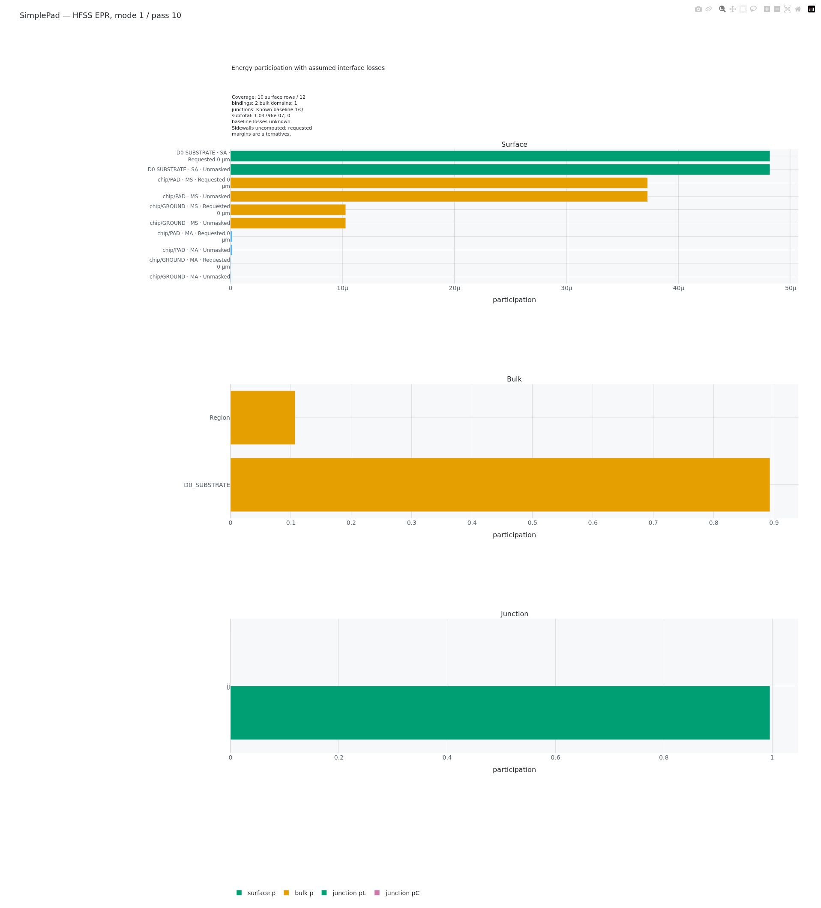

## 1. What you will get

This notebook builds a linear SimplePad resonator, solves one Eigenmode with Palace or HFSS, and plots the returned surface, bulk and branch participation for that mode. Each route includes source construction, native handoff and fresh-session result reading.

{#fig-epr-simple-pad-layout}

The model uses a 200 µm square pad, a 20 µm gap and a 10 nH inductive branch across the east edge. Interface-film and bulk-loss settings are declared assumptions; the notebook reports energy participation, not a measured loss or device lifetime.

## 2. Prepare your environment

Create a project with Python 3.12 or 3.13. Install Git and [uv](https://docs.astral.sh/uv/getting-started/installation/); uv fetches the pinned source repositories and manages this project's `.venv` and `uv.lock`.

```bash
uv init --python 3.12 pad-epr
cd pad-epr
uv add 'scgsim[palace,aedt-epr] @ git+https://github.com/NCUPHY-LTLab/scgsim.git@90fb50ef9de80fa6e556d2f2a09fb45707efeea0' \
  'orpen-sc-pdk @ git+https://github.com/NCUPHY-LTLab/orcapen-sc-pdk.git@51985d9507025e8241205712e866c0b804de29b9' \
  ipykernel
uv run python -c "from importlib.metadata import version; print(version('scgsim'))"
uv run --with jupyter jupyter lab
```

This selects SCGSim `2.0.0rc11` and the SimplePad PDK source revision `51985d9507025e8241205712e866c0b804de29b9` (`orpen-sc-pdk`, imported as `orpen_sc_pdk`).

| Backend | Native software needed on the solver host |
|---|---|
| Palace | Official Palace 0.18.1 plus a site MPI wrapper accepting `-np` and `-nt` |
| HFSS | AEDT 2023.2 or 2024.2, PyAEDT 1.3.0 and a suitable license |

Python extras provide preparation libraries. Install the selected native solver separately. See [SCGSim installation](../course/installation.qmd) for host setup details.

Check: the version command prints `2.0.0rc11`; Jupyter uses this project's Python environment.

## 3. Choose your settings

Edit this cell before preparing a run. Lengths are in micrometres, inductance in henries, film thickness begins in PDK micrometres and is converted to metres for HFSS, and the Palace search target is in hertz.

```{python}
#| id: epr-settings
from pathlib import Path

PAD_SIDE_UM = 200.0
GAP_UM = 20.0
DIE_SIDE_UM = 1000.0
PORT_LOCATOR_WIDTH_UM = 2.0
VACUUM_PADDING_UM = (250.0, 250.0, 1000.0)
PORT_INDUCTANCE_H = 10e-9
PORT_CAPACITANCE_F = 0.0
NUM_MODES = 1
SEARCH_FREQUENCY_HZ = 1e9
EIGENMODE_TOLERANCE = 1e-6
REFINED_MESH_SIZE_UM = 10.0
MAX_MESH_SIZE_UM = 200.0
FEM_ORDER = 2
AMR_MAX_PASSES = 10
AMR_TOLERANCE = 0.02
AEDT_MAXIMUM_PASSES = 10
AEDT_DELTA_FREQUENCY_PERCENT = 1.0
AEDT_VERSION = "2024.2"  # Select 2023.2 or 2024.2 for your licensed host.
INTERFACE_KINDS = ("MA", "MS", "SA")
INTERFACE_PRESET_PREFIX = "LiteratureCentral"
SURFACE_MARGINS_UM = (0.0,)
OUTPUT_ROOT = Path(".artifacts/SimplePad")
PALACE_RUN_ID = "pad-epr-palace-01"
HFSS_RUN_ID = "pad-epr-hfss-01"
PALACE_HANDOFF_NOTE = OUTPUT_ROOT / f"{PALACE_RUN_ID}-handoff.json"

PALACE_EXECUTABLE = "palace"  # Set to your site's MPI wrapper accepting -np/-nt.
PALACE_RESOURCES = {
    "processes": 8,
    "threads": 1,
    "command_style": "wrapper",
}
PALACE_SETUP_COMMANDS = ()
AEDT_CORES = 4
AEDT_RAM_LIMIT_PERCENT = 80
PRESET_NAMES = {
    kind: f"{INTERFACE_PRESET_PREFIX}_{kind}"
    for kind in INTERFACE_KINDS
}
```

Mesh size, FEM order and adaptive controls affect different parts of the numerical request. A maximum pass count is a limit, not a statement that every pass will complete. Review actual returned mode and EPR rows with these settings.

Check: choose the film preset, AEDT release and a fresh run ID before preparing the model.

## 4. Build the model {#prepare-the-shared-geometry}

Both backends use the same explicit `pad` and `ground` Nets, PDK material records and vacuum envelope. The authored port locator connects the physical model to the declared linear branch without adding metal.

### Create the shared source

```{python}
#| id: epr-source
import gdsfactory as gf
import orpen_sc_pdk
from orpen_sc_pdk import (
    get_interface_preset_records,
    get_material_records,
    validate_interface_preset_records,
)
from orpen_sc_pdk.tech import get_single_die_layer_stack
from IPython.display import display
from scgsim.geometry import GeometryPlan

orpen_sc_pdk.activate()
gf.clear_cache()
component = gf.get_component(
    "square_pad_capacitor",
    pad_side_um=PAD_SIDE_UM,
    gap_um=GAP_UM,
    die_side_um=DIE_SIDE_UM,
    junction_width_um=PORT_LOCATOR_WIDTH_UM,
)
layer_stack = get_single_die_layer_stack()
material_records = get_material_records()
plan = GeometryPlan(
    component=component,
    root_id="chip",
    layer_stack=layer_stack,
    material_records=material_records,
    coupon_padding_um=0.0,
)
plan.set_nets({"pad": ("chip/PAD",), "ground": ("chip/GROUND",)})
plan.set_vacuum_region(padding=VACUUM_PADDING_UM)
snapshot = plan.prepare()
interface_records = validate_interface_preset_records(
    get_interface_preset_records()
)
display(component)
print(component.dbbox())
```

The `LiteratureCentral` MA/MS/SA films are attributed synthetic modeling assumptions. The actual result keeps surface, bulk and branch participation separate, so changing one loss assumption does not change the others.

Check: inspect the component preview, explicit pad/Ground Nets and selected film records. See [model and materials](../reference.qmd#model-materials) and [conductors and ports](../reference.qmd#conductors-ports).

## 5. Configure the simulation {#configure-the-mode-calculation}

Select one solver tab. Both request mode 1 with the same inductive source branch and interface assumptions; HFSS also binds each surface contribution to the prepared geometry catalogue.

:::: {.panel-tabset group="epr-backend"}

### Palace

```{python}
#| id: epr-palace-config
from scgsim.palace import EigenmodeSim

PORT_NAME = "chip/o_junction_lumped"
interface_presets = {
    kind: interface_records[PRESET_NAMES[kind]]
    for kind in INTERFACE_KINDS
}
palace_sim = EigenmodeSim()
palace_sim.set_plan(snapshot)
palace_sim.set_output_dir(OUTPUT_ROOT / PALACE_RUN_ID)
palace_sim.set_surface_epr(
    representation="B",
    specs={
        kind: {
            "thickness": interface_presets[kind]["thickness"],
            "permittivity": interface_presets[kind]["permittivity"],
            "loss_tangent": interface_presets[kind]["loss_tangent"],
            "source": interface_presets[kind]["source"],
            "preset": PRESET_NAMES[kind],
        }
        for kind in INTERFACE_KINDS
    },
)
palace_sim.add_port(
    PORT_NAME,
    layer="D0_TOP_M1",
    layout_sheet=True,
    inductance=PORT_INDUCTANCE_H,
)
palace_sim.set_epr_request(
    surface_interfaces=INTERFACE_KINDS,
    bulk_domain_ids=None,
    port_names=(PORT_NAME,),
)
palace_sim.set_eigenmode(
    num_modes=NUM_MODES,
    target=SEARCH_FREQUENCY_HZ,
    tolerance=EIGENMODE_TOLERANCE,
    save=1,
)
palace_sim.set_mesh(
    size_policy="scgsim_default",
    refined_mesh_size=REFINED_MESH_SIZE_UM,
    max_mesh_size=MAX_MESH_SIZE_UM,
)
palace_sim.set_numerical(
    order=FEM_ORDER,
    tolerance=EIGENMODE_TOLERANCE,
    max_iterations=2000,
    solver_type="Default",
    preconditioner="Default",
    device="CPU",
    amr_max_passes=AMR_MAX_PASSES,
    amr_tolerance=AMR_TOLERANCE,
    amr_update_fraction=0.15,
    amr_nonconformal=False,
    save_adapt_iterations=True,
    output_paraview=True,
    output_grid_function=False,
)
```

The explicit `scgsim_default` mesh policy keeps the selected size controls active. Palace's port declares inductance in henries; it does not add a capacitive branch, so `PORT_CAPACITANCE_F = 0.0` remains a model note.

### HFSS

```{python}
#| id: epr-hfss-config
from scgsim.aedt import (
    AedtResources,
    EigenmodeRunControl,
    EigenmodeSim as HfssEigenmodeSim,
    EprAnalysisRequest,
    SurfaceEprSpec,
    planar_junction_from_port,
    prepare_planar_geometry_input,
)

HFSS_RESOURCES = AedtResources(
    cores=AEDT_CORES,
    ram_limit_percent=AEDT_RAM_LIMIT_PERCENT,
)
PORT_NAME = "chip/o_junction_lumped"
junction = planar_junction_from_port(
    snapshot.geometry_input,
    port_name=PORT_NAME,
    junction_id="jj",
    terminal_a_net="pad",
    terminal_b_net="ground",
    inductance_h=PORT_INDUCTANCE_H,
    capacitance_f=PORT_CAPACITANCE_F,
)
prepared_geometry = prepare_planar_geometry_input(
    snapshot.geometry_input,
    prepared_stack=snapshot.stack,
    modeling="solid",
    junctions=(junction,),
)
surface_specs = []
for record in prepared_geometry.contribution_catalog:
    kind = record["interface_kind"]
    if kind not in INTERFACE_KINDS:
        continue
    preset_name = PRESET_NAMES[kind]
    preset = interface_records[preset_name]
    surface_specs.append(SurfaceEprSpec(
        contribution_id=record["contribution_id"],
        source_polygon_id=record["source_polygon_ids"][0],
        interface_kind=kind,
        field_side=record["field_side"],
        margins_um=SURFACE_MARGINS_UM,
        film_thickness_m=preset["thickness"] * 1e-6,
        film_relative_permittivity=preset["permittivity"],
        loss_tangent=preset["loss_tangent"],
        source=preset["source"],
        preset=preset_name,
    ))
hfss_sim = HfssEigenmodeSim(modeling="solid", aedt_version=AEDT_VERSION)
hfss_sim.set_plan(snapshot)
hfss_sim.set_output_dir(OUTPUT_ROOT / HFSS_RUN_ID)
hfss_sim.set_surface_epr(contributions=surface_specs)
hfss_sim.add_junction(junction)
hfss_sim.set_epr_request(EprAnalysisRequest(
    mode_indices=(1,),
    surface_contribution_ids=tuple(
        item.contribution_id for item in surface_specs
    ),
    junction_ids=("jj",),
    bulk_domain_ids=None,
))
hfss_sim.set_eigenmode(
    project_name=HFSS_RUN_ID,
    design_name="SimplePadEigenmodeEpr",
    run_control=EigenmodeRunControl(
        setup_name="Setup1",
        minimum_frequency_ghz=SEARCH_FREQUENCY_HZ / 1e9,
        num_modes=NUM_MODES,
        maximum_passes=AEDT_MAXIMUM_PASSES,
        maximum_delta_frequency_percent=AEDT_DELTA_FREQUENCY_PERCENT,
    ),
    resources=HFSS_RESOURCES,
)
```

HFSS film thickness is converted from micrometres to metres. The catalogue supplies each source contribution, interface kind and field side; the `LiteratureCentral` records supply the explicitly selected film assumptions.

Check: confirm the contribution catalogue, `jj` junction and mode-1 request. See [mesh and adaptation](../reference.qmd#mesh-adaptation).

::::

## 6. Inspect and run

Prepare the selected backend, then inspect its mesh and generated configuration or request before execution. With `command_style="wrapper"`, set `PALACE_EXECUTABLE` to your site's Palace MPI wrapper that accepts `-np` and `-nt`; keep `PALACE_SETUP_COMMANDS` empty for direct-local use, or set it to your site's documented setup commands. For a direct Palace ELF binary, follow the [execution and handoff reference](../reference.qmd#execution-handoff) to choose its matching launcher settings.

:::: {.panel-tabset group="epr-backend"}

### Palace

```{python}
#| id: epr-palace-run
import json

palace_mesh = palace_sim.mesh()
palace_config = palace_sim.write_config()
palace_handoff = palace_sim.prepare_handoff(
    profile="direct-local",
    executable=PALACE_EXECUTABLE,
    resources=PALACE_RESOURCES,
    setup_commands=PALACE_SETUP_COMMANDS,
)
PALACE_HANDOFF_NOTE.parent.mkdir(parents=True, exist_ok=True)
PALACE_HANDOFF_NOTE.write_text(
    json.dumps(
        {
            "run_dir": str(palace_handoff.run_dir),
            "handoff_id": palace_handoff.handoff_id,
        },
        indent=2,
    ),
    encoding="utf-8",
)
print(palace_mesh, palace_config, palace_handoff.run_dir)
print("Saved handoff identity:", PALACE_HANDOFF_NOTE)
```

### HFSS

```{python}
#| id: epr-hfss-run
hfss_handoff = hfss_sim.prepare_handoff()
print(hfss_handoff.spec_path, hfss_handoff.archive_path)
```

::::

Inspect the generated mesh, configuration or HFSS specification and archive. For a remote host, transfer the complete archive and run its script there; the next cells execute locally on the selected solver host.

:::: {.panel-tabset group="epr-backend"}

### Palace

```{python}
#| id: epr-palace-execute
import subprocess

subprocess.run(
    ["bash", str(palace_handoff.script_path)],
    cwd=palace_handoff.run_dir,
    check=True,
)
```

### HFSS

```{python}
#| id: epr-hfss-execute
import subprocess

subprocess.run(
    ["bash", str(hfss_handoff.script_path)],
    cwd=hfss_handoff.run_dir,
    check=True,
)
```

::::

Retrieve the complete returned directory after execution. AEDT Desktop must run on the same host as SCGSim and the selected licensed AEDT release.

Check: preparation prints a unique run directory; after execution retrieve the full package. See [execution and handoff](../reference.qmd#execution-handoff).

## 7. Read and plot results {#display-the-mode-and-participation}

Use a fresh analysis kernel and the generated local run directory. For a transferred return, change only `RETURNED_RUN_DIR` to the returned folder; the independently saved Palace handoff note remains in the study project. Surface, bulk and branch participation are dimensionless. Keep mode identity and, for HFSS, native pass identity with each plotted record.

:::: {.panel-tabset group="epr-backend"}

### Palace

```{python}
#| id: epr-palace-results
import json
from pathlib import Path
from IPython.display import display
from scgsim.palace import resolve_palace_result, show_epr

PALACE_HANDOFF_NOTE = Path(
    ".artifacts/SimplePad/pad-epr-palace-01-handoff.json"
)
handoff_record = json.loads(PALACE_HANDOFF_NOTE.read_text(encoding="utf-8"))
RETURNED_RUN_DIR = Path(handoff_record["run_dir"])
EXPECTED_HANDOFF_ID = handoff_record["handoff_id"]
resolved = resolve_palace_result(
    RETURNED_RUN_DIR,
    expected_handoff_id=EXPECTED_HANDOFF_ID,
)
resolved.show_all_results()
epr_result = resolved.epr_result()
print("Recorded modes:", sorted({row["mode"] for row in epr_result.rows}))
MODE = 1  # Select a mode shown by the previous line.
display(show_epr(epr_result, mode=MODE))
```

Palace reports its port participation with its native signed convention. Read the sign, port name and units of the source model together with the surface and bulk values.

### HFSS

```{python}
#| id: epr-hfss-results
from pathlib import Path
from IPython.display import display
from scgsim.aedt import resolve_results, show_epr, plot_epr_result

RETURNED_RUN_DIR = Path(".artifacts/SimplePad/pad-epr-hfss-01")
resolved = resolve_results(RETURNED_RUN_DIR)
resolved.show_all_results(show_details=True)
epr_history = resolved.epr_result()
print("Recorded mode/pass/status:", sorted({
    (row["mode"], row["native_pass"], row["status"])
    for row in epr_history.rows
}))
MODE = 1
MODE_PASSES = sorted({
    row["native_pass"] for row in epr_history.rows if row["mode"] == MODE
})
if not MODE_PASSES:
    raise ValueError(f"No EPR passes were recorded for mode {MODE}")
NATIVE_PASS = MODE_PASSES[-1]
display(show_epr(epr_history, mode=MODE, native_pass=NATIVE_PASS))
display(plot_epr_result(
    epr_history,
    mode=MODE,
    native_pass=NATIVE_PASS,
    show_convergence=True,
))
```

The code selects the last pass recorded for mode 1; change `MODE` to inspect another mode. The table and plots keep surface contributions, bulk domains, inductive junction participation and capacitive participation as separate quantities.

::::

Check: the plot title identifies the selected mode and HFSS pass; retain dimensionless values with owner/interface labels. See [results and reports](../reference.qmd#results-reports).

### Historical SimplePad observations

The original mode returns used SCGSim 1.0.1; the HFSS EPR table was separately derived from the existing solution with SCGSim 1.0.2rc1.

| Historical mode-1 report | Palace | HFSS |
|---|---:|---:|
| Frequency | 5.137791 GHz | 4.879060 GHz |
| Silicon electric participation | 0.920574 | 0.893092 |
| Vacuum electric participation | 0.079426 | 0.106908 |
| Branch energy participation | signed port 0.993926 | $p_L$ 0.995816; $p_C$ 0 |

{#fig-simple-pad-hfss-epr}

## 8. Adapt this notebook

Change the source dimensions, branch inductance, selected film records and run controls in the central settings cell. Rebuild the source and regenerate the handoff whenever the geometry or material stack changes. Keep the exact interface side, owner, mode and native pass when interpreting contributions.

A zero-loss assumption is not a measured material value, and a participation by itself is not device Q or $T_1$. For the mode-frequency workflow without EPR, use the standalone [resonance notebook](resonance.qmd); for capacitance matrices, use [pad capacitance](capacitance.qmd). The [EPR concepts](../eigenmode-epr.qmd), [Palace Eigenmode reference](../course/palace-eigenmode.qmd) and [AEDT EPR guide](../course/offline-epr.qmd) explain result definitions and additional analysis paths. For later analysis of saved fields or an assumption-only update, see [saved fields and offline loss](../reference.qmd#saved-fields-offline-loss).

Public SimplePad sources at the same PDK revision: [Palace Eigenmode](https://github.com/NCUPHY-LTLab/orcapen-sc-pdk/blob/51985d9507025e8241205712e866c0b804de29b9/notebooks/src/ComponentSimulation/SimplePad/palace_eigenmode.qmd) and [AEDT HFSS Eigenmode](https://github.com/NCUPHY-LTLab/orcapen-sc-pdk/blob/51985d9507025e8241205712e866c0b804de29b9/notebooks/src/ComponentSimulation/SimplePad/aedt_hfss_eigenmode.qmd); the [public evidence index](https://github.com/NCUPHY-LTLab/orcapen-sc-pdk/blob/51985d9507025e8241205712e866c0b804de29b9/notebooks/ComponentSimulation/SimplePad/evidence/README.md) records the original HFSS EPR result as partial and the separate existing-solution observation.

Check: prepare a fresh handoff after each geometry or film-setting change and inspect the returned mode/pass report before reanalysis.
