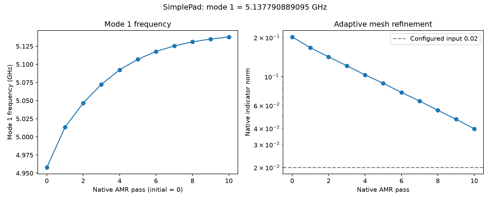

## 1. What you will get

This notebook adds a linear inductive branch to a square pad and surrounding Ground, prepares an Eigenmode run, and reads the returned mode frequency. Choose Palace or HFSS; each route is complete from the shared component through result resolution.

{#fig-simple-pad-palace-em}

The model uses a 200 µm pad, 20 µm gap, 10 nH branch and a 1 GHz search input. The branch is a declared linear circuit element, not a physical measurement or nonlinear qubit model.

## 2. Prepare your environment

Create a study project with Python 3.12 or 3.13. Install Git and [uv](https://docs.astral.sh/uv/getting-started/installation/); uv fetches the pinned Git sources into your project's managed environment.

```bash
uv init --python 3.12 pad-resonance
cd pad-resonance
uv add 'scgsim[palace,aedt] @ git+https://github.com/NCUPHY-LTLab/scgsim.git@90fb50ef9de80fa6e556d2f2a09fb45707efeea0' \
  'orpen-sc-pdk @ git+https://github.com/NCUPHY-LTLab/orcapen-sc-pdk.git@51985d9507025e8241205712e866c0b804de29b9' \
  ipykernel
uv run python -c "from importlib.metadata import version; print(version('scgsim'))"
uv run --with jupyter jupyter lab
```

The pinned SCGSim source is version `2.0.0rc11`. The SimplePad component comes from PDK revision `51985d9507025e8241205712e866c0b804de29b9` (`orpen-sc-pdk`, imported as `orpen_sc_pdk`). uv maintains this project's `.venv` and `uv.lock`.

| Backend | Native software needed on the solver host |
|---|---|
| Palace | Official Palace 0.18.1 plus a site MPI wrapper accepting `-np` and `-nt` |
| HFSS | AEDT 2023.2 or 2024.2, PyAEDT 1.3.0 and a suitable license |

Install the native solver separately from Python. See [SCGSim installation](../course/installation.qmd) for details.

Check: the version command prints `2.0.0rc11`, and Jupyter uses this project's `.venv`.

## 3. Choose your settings

Edit the central cell first. Lengths are in micrometres, inductance in henries, search target in hertz, and AEDT mode controls use GHz and percent.

```{python}
#| id: resonance-settings
from pathlib import Path

PAD_SIDE_UM = 200.0
GAP_UM = 20.0
DIE_SIDE_UM = 1000.0
PORT_LOCATOR_WIDTH_UM = 2.0
VACUUM_PADDING_UM = (250.0, 250.0, 1000.0)

PORT_INDUCTANCE_H = 10e-9
PORT_CAPACITANCE_F = 0.0
NUM_MODES = 1
SEARCH_FREQUENCY_HZ = 1e9
EIGENMODE_TOLERANCE = 1e-6

REFINED_MESH_SIZE_UM = 10.0
MAX_MESH_SIZE_UM = 200.0
FEM_ORDER = 2
AMR_MAX_PASSES = 10
AMR_TOLERANCE = 0.02
AEDT_MAXIMUM_PASSES = 10
AEDT_DELTA_FREQUENCY_PERCENT = 1.0
AEDT_VERSION = "2024.2"  # Select 2023.2 or 2024.2 for your licensed host.
OUTPUT_ROOT = Path(".artifacts/SimplePad")
PALACE_RUN_ID = "pad-resonance-palace-01"
HFSS_RUN_ID = "pad-resonance-hfss-01"
PALACE_HANDOFF_NOTE = OUTPUT_ROOT / f"{PALACE_RUN_ID}-handoff.json"

PALACE_EXECUTABLE = "palace"  # Set to your site's MPI wrapper accepting -np/-nt.
PALACE_RESOURCES = {
    "processes": 8,
    "threads": 1,
    "command_style": "wrapper",
}
PALACE_SETUP_COMMANDS = ()
AEDT_CORES = 4
AEDT_RAM_LIMIT_PERCENT = 80
```

The search target helps locate a mode; it is not the solved frequency. Mesh sizes, FEM order and adaptive controls have separate effects. Palace uses hertz for its target; HFSS uses GHz in its run-control record.

Check: review the units and choose a fresh run ID before preparing another model.

## 4. Build the model

Both backends consume one GeometryPlan snapshot with explicit pad and Ground Net membership and the same vacuum envelope.

### Create the shared source

```{python}
#| id: resonance-source
import gdsfactory as gf
import orpen_sc_pdk
from orpen_sc_pdk import get_material_records
from orpen_sc_pdk.tech import get_single_die_layer_stack
from IPython.display import display
from scgsim.geometry import GeometryPlan

orpen_sc_pdk.activate()
gf.clear_cache()
component = gf.get_component(
    "square_pad_capacitor",
    pad_side_um=PAD_SIDE_UM,
    gap_um=GAP_UM,
    die_side_um=DIE_SIDE_UM,
    junction_width_um=PORT_LOCATOR_WIDTH_UM,
)
layer_stack = get_single_die_layer_stack()
material_records = get_material_records()
plan = GeometryPlan(
    component=component,
    root_id="chip",
    layer_stack=layer_stack,
    material_records=material_records,
    coupon_padding_um=0.0,
)
plan.set_nets({"pad": ("chip/PAD",), "ground": ("chip/GROUND",)})
plan.set_vacuum_region(padding=VACUUM_PADDING_UM)
snapshot = plan.prepare()
display(component)
print(component.dbbox())
```

The component supplies the authored non-metal port locator across the east-edge gap. The branch adds the declared inductance; it does not create a physical metal bridge.

Check: the preview shows the component and authored locator; the snapshot includes the explicit pad and Ground Nets. See [model and materials](../reference.qmd#model-materials) and [conductors and ports](../reference.qmd#conductors-ports).

## 5. Configure the simulation

Choose one solver tab and run its cells in order. Palace and HFSS each receive an explicit 10 nH branch, one-mode request and host-specific controls.

:::: {.panel-tabset group="resonance-backend"}

### Palace

```{python}
#| id: resonance-palace-config
from scgsim.palace import EigenmodeSim

palace_sim = EigenmodeSim()
palace_sim.set_plan(snapshot)
palace_sim.set_output_dir(OUTPUT_ROOT / PALACE_RUN_ID)
PORT_NAME = "chip/o_junction_lumped"
palace_sim.add_port(
    PORT_NAME,
    layer="D0_TOP_M1",
    layout_sheet=True,
    inductance=PORT_INDUCTANCE_H,
)
palace_sim.set_eigenmode(
    num_modes=NUM_MODES,
    target=SEARCH_FREQUENCY_HZ,
    tolerance=EIGENMODE_TOLERANCE,
    save=1,
)
palace_sim.set_mesh(
    size_policy="scgsim_default",
    refined_mesh_size=REFINED_MESH_SIZE_UM,
    max_mesh_size=MAX_MESH_SIZE_UM,
)
palace_sim.set_numerical(
    order=FEM_ORDER,
    tolerance=EIGENMODE_TOLERANCE,
    max_iterations=2000,
    solver_type="Default",
    preconditioner="Default",
    device="CPU",
    amr_max_passes=AMR_MAX_PASSES,
    amr_tolerance=AMR_TOLERANCE,
    amr_update_fraction=0.15,
    amr_nonconformal=False,
    save_adapt_iterations=True,
    output_paraview=True,
    output_grid_function=False,
)
```

The explicit `scgsim_default` mesh policy makes the 10 µm and 200 µm size controls active. The Palace port accepts inductance in henries; `PORT_CAPACITANCE_F` is zero and Palace does not add a capacitive branch through this port API.

### HFSS

```{python}
#| id: resonance-hfss-config
from scgsim.aedt import (
    AedtResources,
    EigenmodeRunControl,
    EigenmodeSim as HfssEigenmodeSim,
    planar_junction_from_port,
)

HFSS_RESOURCES = AedtResources(
    cores=AEDT_CORES,
    ram_limit_percent=AEDT_RAM_LIMIT_PERCENT,
)
junction = planar_junction_from_port(
    snapshot.geometry_input,
    port_name="chip/o_junction_lumped",
    junction_id="jj",
    terminal_a_net="pad",
    terminal_b_net="ground",
    inductance_h=PORT_INDUCTANCE_H,
    capacitance_f=PORT_CAPACITANCE_F,
)
hfss_sim = HfssEigenmodeSim(modeling="solid", aedt_version=AEDT_VERSION)
hfss_sim.set_plan(snapshot)
hfss_sim.set_output_dir(OUTPUT_ROOT / HFSS_RUN_ID)
hfss_sim.add_junction(junction)
hfss_sim.set_eigenmode(
    project_name=HFSS_RUN_ID,
    design_name="SimplePadEigenmode",
    run_control=EigenmodeRunControl(
        setup_name="Setup1",
        minimum_frequency_ghz=SEARCH_FREQUENCY_HZ / 1e9,
        num_modes=NUM_MODES,
        maximum_passes=AEDT_MAXIMUM_PASSES,
        maximum_delta_frequency_percent=AEDT_DELTA_FREQUENCY_PERCENT,
    ),
    resources=HFSS_RESOURCES,
)
```

HFSS records a source-linked lumped junction between the named Nets. The maximum delta frequency is an adaptive stopping input; it does not by itself determine whether the result is adequate for your study.

Check: confirm the selected AEDT release, junction Net identities and 10 nH request. See [mesh and adaptation](../reference.qmd#mesh-adaptation).

::::

## 6. Inspect and run

Prepare the selected backend, then inspect its mesh and generated configuration or request before execution. With `command_style="wrapper"`, set `PALACE_EXECUTABLE` to your site's Palace MPI wrapper that accepts `-np` and `-nt`; keep `PALACE_SETUP_COMMANDS` empty for direct-local use, or set it to your site's documented setup commands. For a direct Palace ELF binary, follow the [execution and handoff reference](../reference.qmd#execution-handoff) to choose its matching launcher settings.

:::: {.panel-tabset group="resonance-backend"}

### Palace

```{python}
#| id: resonance-palace-run
import json

palace_mesh = palace_sim.mesh()
palace_config = palace_sim.write_config()
palace_handoff = palace_sim.prepare_handoff(
    profile="direct-local",
    executable=PALACE_EXECUTABLE,
    resources=PALACE_RESOURCES,
    setup_commands=PALACE_SETUP_COMMANDS,
)
PALACE_HANDOFF_NOTE.parent.mkdir(parents=True, exist_ok=True)
PALACE_HANDOFF_NOTE.write_text(
    json.dumps(
        {
            "run_dir": str(palace_handoff.run_dir),
            "handoff_id": palace_handoff.handoff_id,
        },
        indent=2,
    ),
    encoding="utf-8",
)
print(palace_mesh, palace_config, palace_handoff.run_dir)
print("Saved handoff identity:", PALACE_HANDOFF_NOTE)
```

### HFSS

```{python}
#| id: resonance-hfss-run
hfss_handoff = hfss_sim.prepare_handoff()
print(hfss_handoff.spec_path, hfss_handoff.archive_path)
```

::::

Inspect the generated mesh, configuration or HFSS specification and archive. For a remote host, transfer the complete archive and run its script there; the next cells execute locally on the selected solver host.

:::: {.panel-tabset group="resonance-backend"}

### Palace

```{python}
#| id: resonance-palace-execute
import subprocess

subprocess.run(
    ["bash", str(palace_handoff.script_path)],
    cwd=palace_handoff.run_dir,
    check=True,
)
```

### HFSS

```{python}
#| id: resonance-hfss-execute
import subprocess

subprocess.run(
    ["bash", str(hfss_handoff.script_path)],
    cwd=hfss_handoff.run_dir,
    check=True,
)
```

::::

Keep the complete returned directory intact for resolution.

Check: preparation prints a new run directory; after execution retrieve the full package. See [execution and handoff](../reference.qmd#execution-handoff).

## 7. Read and plot results

Resolve the generated local run directory in a fresh kernel. For a transferred return, change only `RETURNED_RUN_DIR` to the returned folder; the independently saved Palace handoff note remains in the study project.

:::: {.panel-tabset group="resonance-backend"}

### Palace

```{python}
#| id: resonance-palace-results
import json
from pathlib import Path
from scgsim.palace import resolve_palace_result

PALACE_HANDOFF_NOTE = Path(
    ".artifacts/SimplePad/pad-resonance-palace-01-handoff.json"
)
handoff_record = json.loads(PALACE_HANDOFF_NOTE.read_text(encoding="utf-8"))
RETURNED_RUN_DIR = Path(handoff_record["run_dir"])
EXPECTED_HANDOFF_ID = handoff_record["handoff_id"]
result = resolve_palace_result(
    RETURNED_RUN_DIR,
    expected_handoff_id=EXPECTED_HANDOFF_ID,
)
result.show_all_results()
```

Read mode 1's frequency in GHz from the Eigenmode report. Keep its mode identity and recorded native controls with the value.

### HFSS

```{python}
#| id: resonance-hfss-results
from pathlib import Path
from scgsim.aedt import resolve_results

RETURNED_RUN_DIR = Path(".artifacts/SimplePad/pad-resonance-hfss-01")
result = resolve_results(RETURNED_RUN_DIR)
result.show_all_results(show_details=True)
physics_rows = result.physics_results()
physics_rows
```

Read the requested mode frequency in GHz from the returned physics rows and report. Retain the mode number and units when copying a value.

::::

Check: the resolved report identifies mode 1 and its frequency unit. See [results and reports](../reference.qmd#results-reports).

### Historical SimplePad mode observations

The published values used SCGSim 1.0.1. They are example report entries, not expected values for a new run or evidence that the backends share one field model.

| Historical mode-1 report | Frequency |
|---|---:|
| Palace Eigenmode | 5.137791 GHz |
| HFSS Eigenmode | 4.879060 GHz |

## 8. Adapt this notebook

Change the pad dimensions, gap, vacuum padding and inductance in the central settings cell, then rebuild the shared source before preparing another run. Keep the source `pad` and `ground` Nets explicit. A mode-only study can omit the junction; this example includes it to represent a linear LC branch.

Check: inspect the updated component and mode request before sending a new handoff.

Use the standalone [capacitance notebook](capacitance.qmd) for a C/G extraction and the separate [resonance and EPR notebook](resonance-epr.qmd) when mode energy partition is part of the question. See the [Palace Eigenmode reference](../course/palace-eigenmode.qmd) and [AEDT Eigenmode reference](../course/aedt-eigenmode.qmd) for additional solver controls.

Public source cases at the same PDK revision: [Palace SimplePad Eigenmode](https://github.com/NCUPHY-LTLab/orcapen-sc-pdk/blob/51985d9507025e8241205712e866c0b804de29b9/notebooks/src/ComponentSimulation/SimplePad/palace_eigenmode.qmd) and [AEDT HFSS Eigenmode](https://github.com/NCUPHY-LTLab/orcapen-sc-pdk/blob/51985d9507025e8241205712e866c0b804de29b9/notebooks/src/ComponentSimulation/SimplePad/aedt_hfss_eigenmode.qmd).
